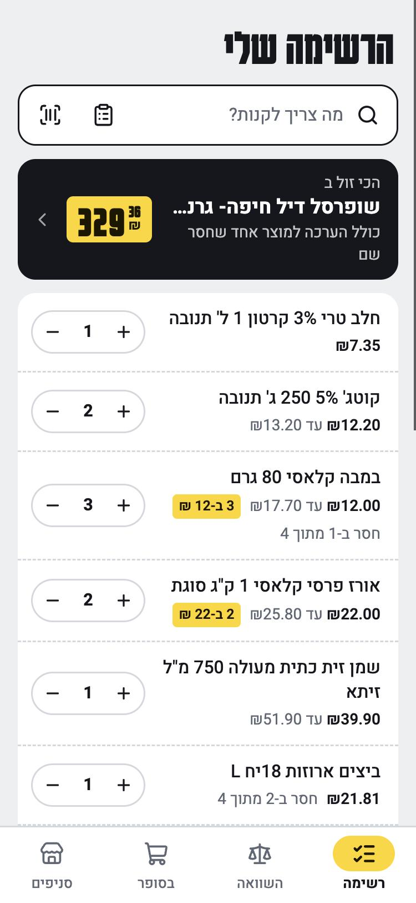
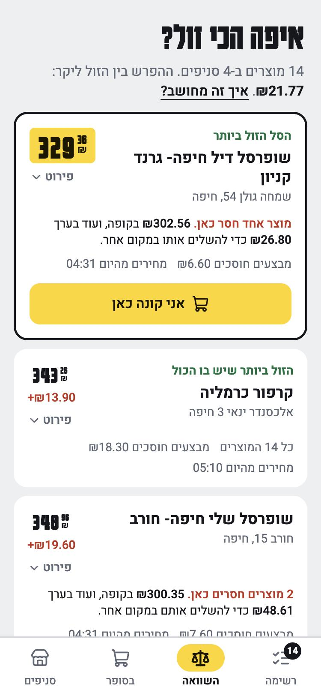
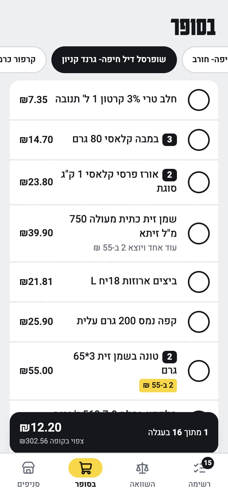

# סל חכם

רשימת קניות שמשווה מחירים אמיתיים בין הסופרים שאתה קונה בהם. אפליקציית מובייל (PWA) שמותקנת למסך הבית,
עובדת גם בלי קליטה בתוך הסופר, ועולה 0 ₪ להפעלה: אין שרת, אין מסד נתונים, אין הרשמה.

המחירים והמבצעים מגיעים מהקבצים שרשתות המזון מחויבות לפרסם לפי חוק שקיפות המחירים.

<p>
  
  
  
</p>

## מה יש באפליקציה

- **רשימה**: חיפוש מוצר בעברית, סריקת ברקוד, או רשימה שלמה בבת אחת: אומרים אותה בקול (גם ברצף: "קוטג' לחם עגבניות ולחם פרוס" נחתך לארבעה מוצרים לפי שמות המוצרים בסניפים שבחרת, ו"שתי עגבניות" הופך ל-2), מצלמים אותה או צילום מסך שלה (הטקסט נקרא בטלפון עצמו, עם Tesseract), או מדביקים מוואטסאפ ("2 חלב", "לחם x3"). "אשר הכול" מצמיד לכל השורות את המוצר המוצע בלחיצה אחת.
- **השוואה**: כמה כל הסל עולה בכל סניף, כולל מבצעים ("2 ב-10"), מוצרים חסרים, והצעה לפצל את הקנייה
  לשני סניפים כשזה חוסך מעל הרף שהגדרת.
- **בסופר**: הרשימה כצ'קליסט גדול ליד אחת, עם סכום מצטבר ורמז כשחסרה יחידה אחת למבצע.
- **תחליפים**: כשסניף לא מוכר את המוצר המדויק (מותג פרטי, ירקות), האפליקציה מציעה מוצר דומה באותו סניף.
- **סניפים**: "מצא סופרים לידי" מציע סניף אחד מכל רשת מובילה באזור, מסומן מראש, ואישור אחד מספיק כדי
  להתחיל. אפשר גם לבחור ידנית עד 8 סניפים לפי עיר, רשת או שם. המיקום מחושב במכשיר ולא נשלח לשום מקום.
  רק המחירים של הסניפים שנבחרו יורדים למכשיר (בערך 150KB לסניף).
- **נוחות**: ביטול מחיקה, שיתוף הרשימה כטקסט, מחיר בכל סניף ישר מתוצאות החיפוש, מסך שנשאר דולק במצב
  "בסופר", והסבר מובנה איך לקרוא את המחירים.
- **נגישות**: שלושה גדלי טקסט (כפתור "הגדל טקסט" כבר במסך הראשון), כפתור החזרה של הטלפון סוגר את מה שפתוח
  במקום לצאת מהאפליקציה, כפתורי "חזרה" ו"סגור" עם מילים ולא רק אייקון, כפתור "עזרה" בכל מסך, ואישור כתוב
  על כל פעולה (למשל "נוסף לרשימה").

## להריץ במחשב

```bash
npm install
```

```bash
npm run sync
```

```bash
npm run dev
```

`npm run sync` מוריד את קובצי המחירים של היום (כמה דקות) אל `public/data`. לבדיקה מהירה אפשר להגביל:

```bash
npm run sync -- --cities "חיפה,נשר" 
```

```bash
npm run sync -- --chains shufersal,carrefour --limit 10
```

בדיקות אוטומטיות למנוע ההשוואה:

```bash
npm test
```

כדי לנסות בטלפון באותה רשת Wi-Fi: `npm run dev -- --host` ולפתוח את הכתובת שמודפסת. סריקת ברקוד במצלמה
דורשת HTTPS, ולכן תעבוד רק אחרי העלאה לאוויר (או ב-localhost).

## להעלות לאוויר בחינם (GitHub Pages)

1. פותחים מאגר **ציבורי** ב-GitHub ודוחפים אליו את התיקייה הזו.
2. במאגר: Settings → Pages → Source: **GitHub Actions**.
3. ה-workflow שב-`.github/workflows/sync-prices.yml` רץ כל שעה (בדקה 17), מוריד מחירים, בונה ומפרסם.
   אפשר גם להריץ אותו ידנית מלשונית Actions.

בטלפון פותחים את הכתובת (`https://<user>.github.io/<repo>/`) ובוחרים "הוסף למסך הבית".

### רשתות שחוסמות גישה מחוץ לישראל

השרתים של GitHub יושבים בחו"ל, וחלק מהרשתות חוסמות אותם: קרפור, ויקטורי, מחסני השוק, חצי חינם,
סופר-פארם, נתיב החסד וח. כהן. את המחירים שלהן מביאים ממחשב בישראל:

```bash
npm run deploy:israel
```

הפקודה בודקת אילו רשתות חסרות באתר, מורידה רק אותן, מעלה אותן כקובץ אחד ל-release בשם `local-data`
ומבקשת מ-GitHub לבנות מחדש. העדכון השעתי ממשיך להשתמש בקובץ הזה עד להרצה הבאה. היא פועלת תמיד בשם
החשבון שהמאגר שייך לו (דורשת ש-`gh` יהיה מחובר אליו), גם אם חשבון אחר פעיל במחשב. רשת שלא עודכנה יומיים
מסומנת באפליקציה כ"מחירים מלפני N ימים".

במק של גיא זה רץ לבד כל שעה, בדקה 2 (לפני הבנייה של האתר בדקה 17), דרך `scripts/hourly-israel.sh`
ומשימת launchd בשם `io.github.guymaslawi.salhacham.israel`. היא רצה מעותק נפרד של המאגר ב-
`~/Library/Application Support/SalHachamSync/repo`, כי macOS לא נותן למשימות רקע לקרוא מ-Documents.
ההרצה השעתית ממשיכה מהנתונים של ההרצה הקודמת ששמורים במק, ומעלה רק כשרשת פרסמה מחירים חדשים. היא רצה
רק כשהמק דלוק ומחובר; אחרי שינה היא רצה פעם אחת כשהוא מתעורר. עצירה:
`launchctl bootout gui/$(id -u)/io.github.guymaslawi.salhacham.israel`. יומן: `~/Library/Logs/SalHacham/`.

עוד שני דברים:

- אם רשת בודדת נכשלת, היא פשוט תחסר באותו יום. אם פחות מ-400 סניפים חוזרים, הריצה נכשלת והאתר של אתמול
  נשאר באוויר.
- GitHub משבית workflow מתוזמן במאגר שלא הייתה בו פעילות 60 יום. הרצה ידנית או commit מחזירים אותו.

## איך זה בנוי

```
scripts/sync/        צינור הנתונים (רץ ב-Node, לא בדפדפן)
  chains.ts          מתאם לכל אתר פרסום: איך מקבלים את רשימת הקבצים ואיך מורידים קובץ
  parse.ts           פענוח Stores / PriceFull / PromoFull
  normalize.ts       ברקודים, יחידות מידה, שמות ערים (לפי קודי הלמ"ס)
  index.ts           מריץ הכול וכותב index.json + קובץ gzip לכל סניף
  israel-only.ts     מביא ממחשב בישראל את הרשתות שחוסמות את GitHub
scripts/make-city-coords.ts   חד-פעמי: מיקום לכל עיר (נשמר ב-scripts/data/city-coords.json)
src/
  data/catalog.ts    קטלוג בזיכרון של הסניפים שנבחרו, חיפוש, הצעת תחליפים
  data/remote.ts     הורדת הנתונים ושמירתם ב-IndexedDB
  engine/optimizer.ts  עלות הסל בכל סניף ופיצול לשני סניפים
  engine/nearby.ts   הצעת הרשתות המובילות באזור של המשתמש
  lib/pricing.ts     חישוב מבצעים ומחיר ליחידת מידה
  state/             הרשימה וההעדפות (localStorage), נתוני המחירים, ניווט
  screens/           המסכים
```

הנתונים נשמרים כקובץ אחד לכל סניף, כך שהטלפון מוריד רק את הסניפים שנבחרו ומחשב הכול מקומית.

## רשתות

29 רשתות, לפי [הרשימה הרשמית של הרשות להגנת הצרכן](https://www.gov.il/he/pages/cpfta_prices_regulations):

- אתר משלהן: שופרסל, קרפור, חצי חינם, סופר-פארם, נתיב החסד, סיטי מרקט, משנת יוסף.
- השרת המשותף publishedprices.co.il (כניסה בשם המשתמש הציבורי שכל רשת מפרסמת, בלי סיסמה): רמי לוי,
  יוחננוף, אושר עד, טיב טעם, קשת טעמים, סטופ מרקט, פוליצר, פרש מרקט, דור אלון (AM:PM).
- laibcatalog.co.il: ויקטורי, מחסני השוק, ח. כהן.
- פורטל Bina: קינג סטור, מעיין 2000, שוק העיר, זול ובגדול, שפע ברכת השם, סופר ספיר, סיטי מרקט (קרית גת),
  משנת יוסף (קיי.טי), סופר ברקת, גוד פארם.

לא נכללות:

- רשתות שהגישה אליהן בשרת המשותף דורשת סיסמה: סאלח דבאח, סופר יודה ויילו. הושארו בחוץ בכוונה.
- וולט: חנויות משלוחים, לא סניפים שאפשר להיכנס אליהם.

הוספת רשת היא מתאם אחד ב-`scripts/sync/chains.ts` שמממש `list()` ו-`download()`. כל השאר משותף.

## מגבלות ידועות

- המבצעים שנספרים הם רק כאלה שאפשר לבטא כ"קנה N ב-X ₪" בלי תנאי נוסף. קופונים, מבצעי "בקנייה מעל…"
  ומתנות לא נספרים, כדי לא להציג מחיר שלא תקבל בפועל.
- מוצרים בלי ברקוד אחיד (ירקות, מאפים, מעדנייה) מזוהים רק בתוך אותה רשת; בין רשתות מחברים אותם דרך "תחליף".
- בקבצים אין מיקום מדויק לסניף, רק עיר. לכן "לידי" פירושו העיר הקרובה, ובתוך עיר גדולה מוצע הסניף הגדול
  של כל רשת ולא בהכרח הקרוב ביותר. אפשר להחליף אותו בלחיצה על "סניף אחר".
- המחיר בקופה הוא הקובע. האתר בודק קבצים חדשים כל שעה, אבל כל רשת מפרסמת בקצב שלה, וייתכנו פערים מהמדף.
